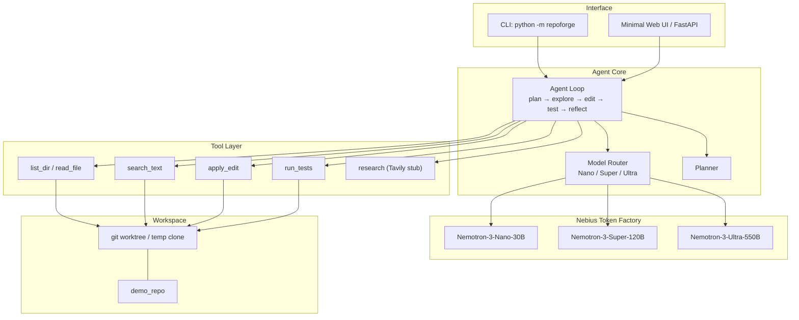

# RepoForge — 项目计划

> **Devpost one-liner (EN):** RepoForge is a coding agent that plans with NVIDIA Nemotron Ultra/Super, explores your repo, writes patches, runs tests in a sandbox, and iterates until green — via Nebius Token Factory.

**Hackathon:** Nebius × NVIDIA Global AI Hackathon — Coding & Agentic Engineering Track  
**Deadline:** ~2026-10-30 10:00 PDT（约 2026-10-31 01:00 Asia/Shanghai）  
**窗口：** 约 13 天（2026-10-17 → 10-30）

---

## 1. 问题与受众

### 问题
开发者拿到一个 GitHub 仓库 + 自然语言任务（修测试、加功能、修 bug）时，现有方案大多是：
- **补全式 IDE 插件**：单文件上下文，不会主动跑测试、不会闭环迭代；
- **通用聊天机器人**：需要人手动粘贴文件、复制报错；
- **重型云 Agent**：贵、不透明、难本地复现。

**RepoForge** 要做的是：**以仓库为工作区的闭环 coding agent** —— 规划 → 探索 → 改代码 → 跑测试 → 对失败反思，尽量少人工介入。

### 受众
- 开源维护者 / 周末黑客：快速修 CI 红灯；
- 学生与黑客松选手：在陌生仓库上完成小任务；
- 小团队：把「修测试」类工单半自动化。

### 为何不是「又一个 code-completion 套壳」
| 维度 | 补全包装 | RepoForge |
|------|---------|-----------|
| 工作单元 | 光标附近 | 整仓 + 任务 |
| 验证 | 无 / 靠人 | 沙箱跑测试 |
| 模型路由 | 单一模型 | Nano 探索 / Super·Ultra 规划与硬推理 |
| 失败处理 | 停止 | reflect → 再探索/再改 |
| 可复现 | 会话绑定 | CLI + API + mock dry-run |

非显而易见点：
1. **分层模型路由**（成本 × 质量）挂在 Token Factory 的 Nemotron 家族上；
2. **相位机（phase machine）** 比自由 ReAct 更可控，便于 demo 与评测；
3. **无 key 可 dry-run**，评委与 CI 都能本地复现闭环。

---

## 2. 架构



**技术栈**
- Python 3.11+
- FastAPI + 极简 HTML UI；CLI（Typer + Rich）优先
- `openai` SDK → `https://api.tokenfactory.nebius.com/v1/` + `NEBIUS_API_KEY`
- 可选 Tavily（研究奖金赛道）— MVP 仅 stub

---

## 3. Agent 循环

```
plan → explore → edit → test → reflect
         ↑__________________|
              (retry)
```

1. **plan**：Super/Ultra 产出 JSON 计划（goal / steps / risk）
2. **explore**：Nano 调 `list_dir` / `read_file` / `search_text`
3. **edit**：Nano（或困难时 Super）调 `apply_edit`（精确 old→new）
4. **test**：跑 `pytest` / `npm test`（沙箱 cwd = repo root）
5. **reflect**：根据测试输出决定 `done` 或 `retry`（回 explore/edit）

退出条件：reflect=`done`，或达到 `max_iterations`（默认 8）。

---

## 4. 模型路由策略

| 相位 | 默认 | 升级条件 |
|------|------|----------|
| plan | Super | 任务含 architecture/refactor/security/concurrency 等 → **Ultra** |
| explore | Nano | — |
| edit | Nano | 连续失败 ≥2 或 hard 关键词 → Super |
| test | Nano | （主要是工具调用，几乎不耗推理） |
| reflect | Nano | failure_count>0 → Super |

模型 ID（Token Factory）：
- Nano: `nvidia/NVIDIA-Nemotron-3-Nano-30B-A3B`
- Super: `nvidia/nemotron-3-super-120b-a12b`
- Ultra: `nvidia/Nemotron-3-Ultra-550b-a55b`

原则：**能用 Nano 就不用 Super；能用 Super 就不用 Ultra**，把 Ultra 留给第一次规划和真正难的反思。

---

## 5. MVP（13 天）vs Stretch

### MVP（必须交付）
- [x] PLAN + README + MIT
- [x] 可 dry-run 的 CLI 闭环（mock LLM）在 `demo_repo` 上修红测试
- [x] Token Factory 客户端封装（有 key 即 live）
- [x] 工具：list/read/search/edit/run_tests
- [x] FastAPI `/health` + `/api/run` + 极简网页
- [x] 基础单测（scaffold + dry-run e2e）
- [ ] 真实 Token Factory 联调（需 credits / key）
- [ ] ≤3 min demo 视频 + Devpost

### Stretch
- GitHub URL → temp clone / worktree
- 真正的 git diff / commit / PR 草稿
- Tavily 研究工具接实 + 引用进 plan
- 多语言测试发现（go test, cargo test）
- 并行 explore、补丁冲突检测
- 评测集（10 个公开 bugfix 任务）与成功率报表

---

## 6. 日程（Asia/Shanghai，2026-10-17 → 10-30）

| 日 | 日期 | 焦点 |
|----|------|------|
| D0 | 10-17 六 | 立项、脚手架、dry-run 闭环、PLAN/README ← **今天** |
| D1 | 10-18 日 | 修 CLI/API 毛刺；确认 Nebius 账号与 credits |
| D2 | 10-19 一 | Live Token Factory：Nano 冒烟；修正 model id |
| D3 | 10-20 二 | Super/Ultra 规划与路由 A/B；记录成本 |
| D4 | 10-21 三 | Git clone/worktree；安全边界（路径沙箱加固） |
| D5 | 10-22 四 | 测试 runner 扩展；失败日志切片给 reflect |
| D6 | 10-23 五 | Web UI 可用性；流式事件（可选 SSE） |
| D7 | 10-24 六 | Tavily stub→实装（若冲奖金）；否则加深 demo 场景 |
| D8 | 10-25 日 | 2–3 个真实开源小 bug 试跑；记案例 |
| D9 | 10-26 一 | 稳定性、超时、重试；README 截图 |
| D10| 10-27 二 | 录制 demo 视频脚本；打磨叙事 |
| D11| 10-28 三 | 拍 ≤3min YouTube；公开 repo |
| D12| 10-29 四 | Devpost 文案、反馈表、最后 bugfix |
| D13| 10-30 五 | **提交**（注意 PDT 截止 = 上海次日凌晨） |

---

## 7. 提交清单（Submission checklist）

- [ ] **Public GitHub repo**（MIT LICENSE + 英文 README）
- [ ] **Demo URL**（本地也可：录屏展示 `python -m repoforge` + 可选部署）
- [ ] **≤3 min YouTube** 演示 plan→…→green tests
- [ ] **Devpost**：英文 one-liner + 故事 + 技术栈 + Token Factory / Nemotron 用法
- [ ] **Feedback text**（按主办方表格）
- [ ] 确认未提交真实 API key（仅 `.env.example`）

---

## 8. 评审标准映射（Judging → 我们怎么打）

| 可能标准 | RepoForge 证据 |
|----------|----------------|
| Innovation | 相位机 + Nemotron 分层路由；非聊天套壳 |
| Technical execution | dry-run e2e、真实工具、FastAPI、可测 |
| Use of Nebius / NVIDIA | Token Factory OpenAI 兼容 + Nano/Super/Ultra |
| Impact / usefulness | 「给 repo + 自然语言 → 测试变绿」 |
| Presentation | 清晰 README、demo_repo 故事、≤3min 视频 |
| Bonus (Tavily 等) | `research` 工具 stub，日程预留接实 |

---

## 9. 开放问题（需用户确认）

1. **Solo 还是组队？** 影响分工与 Devpost 作者列表。
2. **Nebius Token Factory credits / API key 状态？** 无 key 前保持 `REPOFORGE_DRY_RUN=1`。
3. **是否需要 GitHub OAuth / 在线 clone？** MVP 可只做本地 path；stretch 再加。
4. **Demo 部署**：仅本地录屏，还是要公网（Railway/Fly/Nebius VM）？
5. **是否冲 Tavily $3k 奖金赛道？** 决定 D7 优先级。

---

## 10. 成功标准（本仓库当前目标）

- [x] `PLAN.md` 完整
- [x] 无 key 可运行的 dry-run CLI，在 `demo_repo` 上演示完整闭环
- [x] 清晰下一步：插入真实 Token Factory key 即 live
